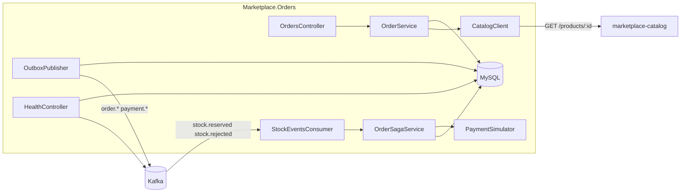
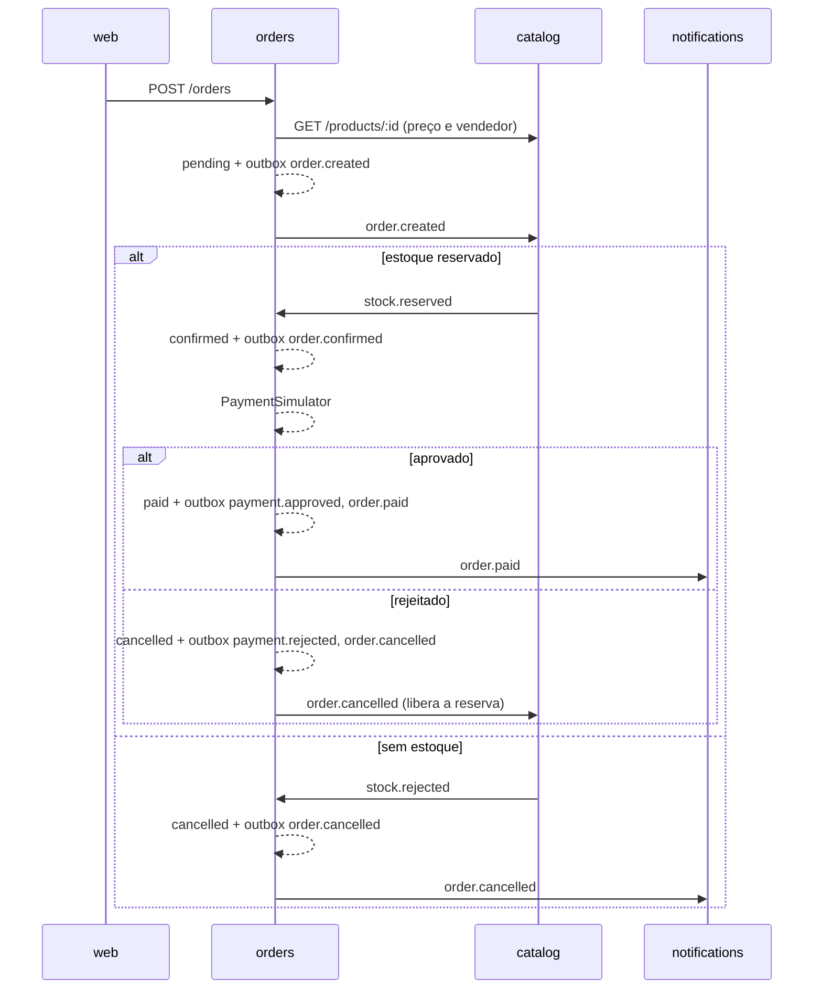

# marketplace-orders

Serviço de pedidos e checkout do marketplace: recebe o pedido do comprador,
conduz a saga com o catálogo (reserva de estoque) e o pagamento simulado, e
publica os eventos `order.*` e `payment.*` que o resto do ecossistema consome.

[](https://github.com/deborahdalonso/marketplace-orders/actions/workflows/ci.yml)
[](LICENSE)

## Stack

- .NET 8, ASP.NET Core Web API com controllers
- EF Core 8 + Pomelo (MySQL 8.4), migrations aplicadas no boot
- Confluent.Kafka (Redpanda em desenvolvimento)
- JWT RS256 validado pelo JWKS do `marketplace-auth`
- FluentValidation
- xUnit, SQLite em memória e `WebApplicationFactory` nos testes
- `dotnet format` como lint

## Como rodar

Pré-requisitos: .NET SDK 8, MySQL e Redpanda do repositório `marketplace`
(`docker compose up -d` lá). O schema `marketplace_orders` já é criado pelo
`init.sql` daquele compose; as tabelas vêm das migrations deste serviço.

Local:

```bash
cp .env.example .env
dotnet run --project src/Marketplace.Orders
```

A API sobe em `http://localhost:3002`. As variáveis seguem os nomes do
CONTRATOS (`MYSQL_HOST`, `KAFKA_BROKERS`, `AUTH_URL`, `CATALOG_URL`,
`PAYMENT_APPROVAL_RATE`, `PORT`, `LOG_LEVEL`) e sobrescrevem o
`appsettings.json`.

Docker:

```bash
docker build -t marketplace-orders .
docker run --rm -p 3002:3002 \
  -e MYSQL_HOST=mysql -e KAFKA_BROKERS=redpanda:9092 \
  -e AUTH_URL=http://auth:3003 -e CATALOG_URL=http://catalog:3001 \
  marketplace-orders
```

Nova migration (ferramenta local, sem instalar nada global):

```bash
dotnet tool restore
dotnet ef migrations add NomeDaMudanca --project src/Marketplace.Orders --output-dir Infrastructure/Database/Migrations
```

## Arquitetura



Fluxo de uma requisição: Controller recebe, o `ValidationActionFilter` roda o
validator do body, o Service aplica a regra e grava no `OrdersDbContext`. Erro
de domínio sobe como `DomainException(code, status)` e o `ApiExceptionHandler`
responde o envelope. Controller e Service não têm try/catch.

```
src/Marketplace.Orders/
  Program.cs                 composição: options, DI, auth, Kafka, pipeline HTTP
  Controllers/               OrdersController, HealthController
  Application/               OrderService (REST), OrderSagaService (eventos),
                             PaymentSimulator, OutboxEvents, Validators/
  Domain/                    Order, OrderItem, OutboxMessage, ProcessedEvent,
                             enums, DomainException, Ulid
  Infrastructure/
    Database/                OrdersDbContext, DatabaseOptions, Migrations/
    Kafka/                   OutboxPublisher, StockEventsConsumer, KafkaOptions
    Catalog/                 CatalogClient (HttpClient tipado), CatalogOptions
    Auth/                    JwksConfigurationRetriever, AuthOptions
    Configuration/           ContractEnvironment (MYSQL_HOST -> Database:Host)
  Contracts/                 DTOs, ApiResponse, ApiErrorResponse, Events/
  Middleware/                ApiExceptionHandler, ValidationActionFilter,
                             JwtBearerEnvelopeEvents, ErrorMessages
tests/Marketplace.Orders.Tests/
  Support/                   TestDb (SQLite), FakeCatalogHandler, TestTokens,
                             OrdersApiFactory
  *Tests.cs                  um arquivo por classe testada
```

### Saga do pedido vista daqui



Status possíveis: `pending`, `confirmed`, `paid`, `cancelled`. O comprador só
cancela em `pending` ou `confirmed`.

## Rotas

Todas exigem `Authorization: Bearer <jwt>` exceto `/health`. Resposta sempre
no envelope `{ success, message, data }` ou `{ success: false, message, errors }`.

| Método | Rota | Quem | O que faz |
|---|---|---|---|
| POST | `/orders` | buyer | Cria pedido `pending`; body `{ items: [{ productId, quantity }], paymentMethod: "pix" \| "card" }` |
| GET | `/orders/mine` | buyer | Pedidos do comprador, `?page=1&perPage=20` |
| GET | `/orders/{id}` | dono ou admin | Um pedido com itens |
| GET | `/orders` | admin, seller | Lista com `?status=&sellerId=&page=&perPage=`; seller só com o próprio `sellerId` |
| POST | `/orders/{id}/cancel` | dono | Cancela se `pending` ou `confirmed`; produz `order.cancelled` com `buyer_request` |
| GET | `/health` | público | `{ service, version, mysql, kafka }`; 503 se algo estiver fora |

Status HTTP: 422 validação e produto inexistente, 401 sem token, 403 sem
permissão, 404 pedido inexistente, 409 transição inválida (ex.: cancelar
pedido pago).

## Eventos

Envelope do CONTRATOS 4.1 em todos: `{ eventId, type, version, occurredAt, producer, data }`.
Tópico = `type`, chave = `orderId`.

| Direção | Tópico | Quando | `data` |
|---|---|---|---|
| produz | `order.created` | POST /orders | `orderId, buyerId, items[{productId, quantity}], totalCents` |
| produz | `order.confirmed` | `stock.reserved` recebido | `orderId, buyerId, totalCents` |
| produz | `payment.approved` | simulador aprovou | `orderId, buyerId, totalCents, method` |
| produz | `payment.rejected` | simulador rejeitou | `orderId, buyerId, totalCents, method` |
| produz | `order.paid` | após `payment.approved` | `orderId, buyerId, sellerIds[], items[{productId, sellerId, quantity, priceCents}], totalCents` |
| produz | `order.cancelled` | pagamento rejeitado, sem estoque ou pedido do comprador | `orderId, buyerId, reason` |
| consome | `stock.reserved` | catalog reservou | `orderId` (demais campos ignorados) |
| consome | `stock.rejected` | catalog não tinha estoque | `orderId` |

Produção usa Outbox: o evento é gravado na tabela `outbox` no mesmo
`SaveChanges` da mudança de estado; o `OutboxPublisher` publica a cada
segundo e marca `published_at`. Consumo é idempotente pela tabela
`processed_events` (grupo `marketplace-orders`, commit manual depois de
processar).

## Decisões

- **Controllers, não minimal API.** O serviço tem poucas rotas, mas todas
  com autorização por role, filtro de validação e `CreatedAtAction`. Com
  `[ApiController]` isso fica declarativo e num lugar só; em minimal API
  viraria um punhado de filtros e lambdas no `Program.cs`.
- **Sem MediatR nem CQRS.** São dois serviços de aplicação e cinco casos de
  uso. Um handler por request mais um pipeline de behaviors seria mais código
  de infraestrutura do que de negócio. O `OrdersDbContext` é o repositório.
- **SQLite nos testes.** Os testes de service e saga precisam de transação e
  de `Include`, coisa que o provider InMemory do EF não representa. SQLite em
  memória roda em milissegundos, sem container, e o schema sai do mesmo
  modelo. A única concessão: o `Program` aplica as migrations do MySQL só
  quando o provider é MySQL, e `EnsureCreated` fora disso.
- **Pagamento simulado com taxa configurável.** Não há gateway real no
  portfólio. Sortear a aprovação com `PAYMENT_APPROVAL_RATE` mantém os dois
  ramos da saga vivos (e testáveis com taxa 0 e 1) sem fingir uma integração.
- **JWKS direto, sem OIDC discovery.** O `auth` publica só
  `/.well-known/jwks.json`. Um `IConfigurationRetriever` de 20 linhas entrega
  as chaves ao `ConfigurationManager` do JwtBearer, que já faz cache de 10 min
  e refresh quando aparece um `kid` desconhecido.
- **Variáveis planas do CONTRATOS.** O binder do .NET espera `Database__Host`;
  o contrato pede `MYSQL_HOST`. O `ContractEnvironment` traduz uma na outra
  no boot, e o `appsettings.json` continua com seções normais.
- **Seller em `GET /orders`.** A tabela de permissões diz admin, mas o painel
  do vendedor chama `GET /orders?sellerId=` com o próprio JWT. A rota aceita
  `seller` quando `sellerId` é o próprio id; qualquer outro valor é 403.
- **Health em controller.** O contrato pede um JSON específico no envelope;
  escrever um `ResponseWriter` para o HealthChecks do ASP.NET daria mais
  código do que um controller de 30 linhas.
- **Só xUnit, sem FluentAssertions.** A versão 8 mudou de licença e as
  asserções nativas cobrem o que os testes precisam.

## Testes

```bash
dotnet test
dotnet format --verify-no-changes
```

51 testes: domínio (`Order`, `Ulid`), `OrderService` e `OrderSagaService`
com SQLite em memória e catalog falso via `HttpMessageHandler`,
`PaymentSimulator` com taxa 0 e 1, validators, e a API inteira em memória
(`WebApplicationFactory`) conferindo status e envelope de 401, 403, 404, 422
e 201 com JWT assinado por uma chave de teste.

## Licença

MIT. Veja [LICENSE](LICENSE).
